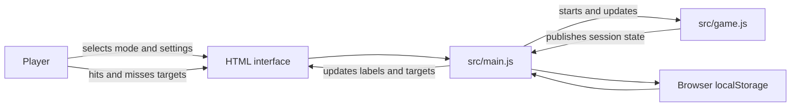

# AimTrain Architecture

## Purpose

AimTrain is a browser-based aim trainer built with HTML, CSS, and JavaScript modules. It runs on the client without an account, server, or third-party game framework.

This document describes the current implementation.

## Project structure

```text
AimTrain/
├── index.html
├── styles/
│   └── main.css
├── src/
│   ├── game.js
│   └── main.js
├── ARCHITECTURE.md
└── README.md
```

## System overview



`main.js` connects the page, game session, modes, settings, and browser storage. `game.js` owns the session timer and hit/miss state. The HTML and CSS define and style the interface.

## Responsibilities

### `index.html`

Provides the semantic page structure:

- Header and live session status
- Mode and difficulty selectors
- Session statistics
- Practice area and target button
- Start panel and restart countdown overlay
- Settings dialog

It loads `src/main.js` as a JavaScript module.

### `styles/main.css`

Defines:

- Page layout, themes, and interface-size variants
- Responsive behavior for narrower screens
- Target and settings dialog appearance
- Hit and miss feedback animations
- Keyboard focus styles and reduced-motion handling

Theme colors are CSS custom properties selected by a theme attribute on the document root.

### `src/main.js`

Coordinates the browser application:

- Checks for required HTML elements
- Creates the session with a 60-second duration
- Connects buttons and selectors to their actions
- Implements Classic and Precision target behavior
- Positions and resizes targets
- Updates the timer, score, misses, accuracy, hit rate, and best score
- Applies settings and saves preferences and the best score in `localStorage`
- Cleans up target, respawn, and restart timers when a round ends or is abandoned

### `src/game.js`

Implements session state and rules independently of the page. It exposes methods to:

- Read the current state
- Subscribe to state updates
- Start or reset a session
- Record hits and misses
- Dispose of the session timer and listeners

The session uses the states `ready`, `running`, and `complete`. AimTrain passes a 60-second duration when creating a session. The module’s default duration is 30 seconds when no duration is supplied.

## Session state

A session state contains:

```text
phase: "ready" | "running" | "complete"
durationSeconds: number
remainingSeconds: number
hits: number
misses: number
```

The session timer uses elapsed time from `performance.now()` and publishes updates while running. Hits and misses are only recorded during the `running` phase. When the remaining time reaches zero, the session becomes `complete`.

## Modes and difficulty

The selected mode and difficulty are managed by `main.js`; they do not change the session-state API in `game.js`.

### Classic

- Targets use the selected difficulty’s base size.
- The target-size preference can use a fixed size or a random size between 75% and 100% of the base.
- A hit creates another target after the selected difficulty’s respawn delay.
- Clicking empty space in the practice area records a miss.

### Precision

- Targets are fixed at 75% of the selected difficulty’s base size.
- A target that is not hit before its lifetime ends is hidden and recorded as a miss.
- The next target appears after the selected difficulty’s respawn delay.
- The game tries up to 24 random positions to find one far enough from the previous target. If it cannot find one, it uses the last position it tried.

Current difficulty settings:

| Difficulty | Base target size | Respawn delay | Precision target lifetime | Precision minimum travel |
| --- | ---: | ---: | ---: | ---: |
| Easy | 60 px | 850 ms | 1,100 ms | 100 px |
| Medium | 46 px | 400 ms | 800 ms | 140 px |
| Hard | 32 px | 150 ms | 550 ms | 180 px |

## Round lifecycle

```text
ready → running → complete
             ↘ restart countdown → ready → running
             ↘ exit to pre-game → ready
```

- **Start:** hides the start panel, displays a target, and starts the session.
- **Hit:** records a hit, shows hit feedback, and schedules the next target.
- **Miss:** an empty-area click records a miss. In Precision mode, an expired target also records a miss.
- **Complete:** the timer ending displays the result and clears outstanding target timers.
- **Restart:** the restart button starts a three-second countdown, then resets and starts a new round.
- **Exit to pre-game:** during the restart countdown, resets the session and returns to the start panel.
- **Play again:** from the results panel, resets and starts a new round.

## Statistics

The interface displays:

- **Score:** total hits
- **Misses:** empty-area clicks and expired Precision targets
- **Accuracy:** `hits / (hits + misses) × 100`; shown as a dash when there have been no attempts
- **Hits per second:** hits divided by elapsed session time
- **Best score:** the highest hit count saved in this browser

The best score is shared across modes and difficulties; it is not stored separately for each one.

## Settings and persistence

Settings are applied by `main.js` and saved locally in the browser:

- Theme: Tactical, Arctic, or Ember
- Interface size: Compact, Standard, or Large
- Classic target size: Varied or Fixed
- Blur behind the settings dialog: On or Off
- Hit sound: On or Off

Settings are stored under keys beginning with `aimtrain.settings.v1`. The best score is stored under `aimtrain.bestscore.v1`.

Storage reads and writes are guarded so the game can still run if browser storage is unavailable. These values are limited to the current browser profile and are not synchronized across devices. There is no session-history storage in the current implementation.

## Input and accessibility

- The target and other actions use HTML buttons, which support keyboard activation.
- Selectors have associated labels.
- The top-bar session status is announced politely to assistive technology.
- Hit and miss feedback uses brief visual border flashes; misses use a distinct color from hits.
- The stylesheet includes visible focus styles and a reduced-motion rule.
- Targets are positioned within the measured play-area bounds.

## Error handling and boundaries

- Missing required page elements produce a clear startup error in `main.js`.
- Storage failures do not prevent a session from running.
- Target-expiry, respawn, and restart timers are cleared when they are no longer needed.
- There is no backend, account system, online leaderboard, multiplayer, or cloud synchronization.

## Local development

Open the project folder in Visual Studio Code and serve `index.html` with the Live Server extension. A local server is recommended because the project uses JavaScript modules.

No package installation or build step is required.
```