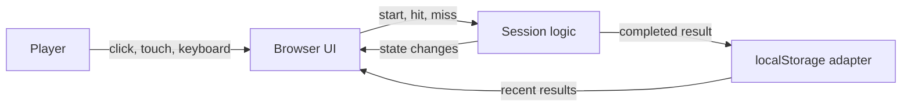

# AimTrain Architecture

## Purpose

AimTrain is a small client-side aim trainer. This document defines the architecture for its first version so implementation can be built against a shared plan. The proposed stack is plain HTML, CSS, and JavaScript modules; there is no backend or account system in the MVP.

## System overview



The browser owns the full application lifecycle. The UI displays the current session, the session logic applies the rules, and the storage module persists completed results when browser storage is available.

## Main parts

### `index.html`

Provides the semantic page structure and app regions: introductory/start screen, practice area, live session statistics, results view, and recent-session history. It loads the JavaScript entry point as a module. It should not contain game rules.

### `styles/main.css`

Defines the visual design, responsive layout, target states, focus styles, and reduced-motion behavior. Styling should make the play area adapt to the available viewport while keeping targets fully inside its bounds.

### `src/main.js`

Application entry point. It finds the required DOM elements, loads saved history, creates the session controller, and connects UI events to game actions. It coordinates modules but should not become the home for scoring or persistence rules.

### `src/game.js`

Owns the session state and rules:

- A session lasts 30 seconds.
- A session begins only after the player activates Start.
- A target click records a hit and moves the target.
- A play-area click outside the target records a miss.
- The timer ending completes the session once.
- Accuracy is hits divided by total shots, expressed as a percentage; it is 0 when there are no shots.

The game module should expose a small API to start, record a hit or miss, subscribe to state changes, and dispose of timers/listeners when needed. It should not directly manipulate the DOM or access `localStorage`.

### `src/ui.js`

Renders state and binds interaction events. It shows the current countdown, hit/miss counts, and accuracy; presents the final result; and handles start/retry controls. It should distinguish clicking the target from clicking empty play-area space, and keep the target operable by keyboard and touch as well as mouse.

### `src/storage.js`

Provides functions to read and write recent session results in `localStorage`. It validates parsed data, handles malformed JSON or unavailable storage without crashing the application, and retains at most 10 results. The stored record contains a stable identifier, completion timestamp, duration, hits, misses, and accuracy.

## Session state and flow

The session moves through three states:

```text
ready -> running -> complete
```

- **ready**: no active timer; the player can start.
- **running**: timer and target are active; valid target and play-area interactions update the counters.
- **complete**: timer has ended; a result is finalized and saved once. The player can start a new session.

Starting a new session resets counters and target position. Completion is idempotent: repeated timer callbacks or clicks after completion must not create extra results or modify the finished score.

## Data model

```text
SessionResult {
  id: string
  completedAt: string   // ISO 8601 timestamp
  durationSeconds: 30
  hits: number
  misses: number
  accuracy: number      // 0–100
}
```

Live state additionally includes the current phase and remaining time. Target position is presentation/session state and does not need to be persisted.

## Persistence behavior

Recent results are stored under one versioned key, such as `aimtrain.results.v1`. Reads should return an empty history when there is no saved value or when storage cannot be accessed. Invalid records should be discarded rather than preventing the trainer from starting. Writes should be best-effort; if they fail, the current session result should still be shown in the UI.

There is no server synchronization. Data is scoped to the browser profile and origin.

## Input, layout, and accessibility

- Keep target coordinates within the measured play-area bounds, accounting for target size.
- Recalculate or clamp target position when the play area resizes.
- Use a semantic button for the target so keyboard activation works.
- Provide visible keyboard focus and text labels for important statistics.
- Avoid using color alone for hit, miss, or completion feedback.
- Respect `prefers-reduced-motion`; animation is optional and should not affect game timing.
- Ensure touch targets and controls remain usable on narrow screens.

## Error handling

Storage errors must not block play. Missing DOM elements needed for core play should be reported clearly during development rather than causing silent failures. Timer cleanup must happen when a session ends or is replaced, so stale timers cannot alter a later session.

## Boundaries and non-goals

The MVP does not include user accounts, a server API, multiplayer, online leaderboards, or cross-device history. Those features would require separate decisions about identity, privacy, data storage, and service operations before adding them.

## Suggested implementation order

1. Create the semantic page structure and responsive play area.
2. Implement session state and timing independently of the DOM.
3. Connect target and play-area interactions to hit/miss updates.
4. Render live stats and the completed result.
5. Add best-effort local result history.
6. Check keyboard, touch, resize, reduced-motion, and storage-failure behavior.